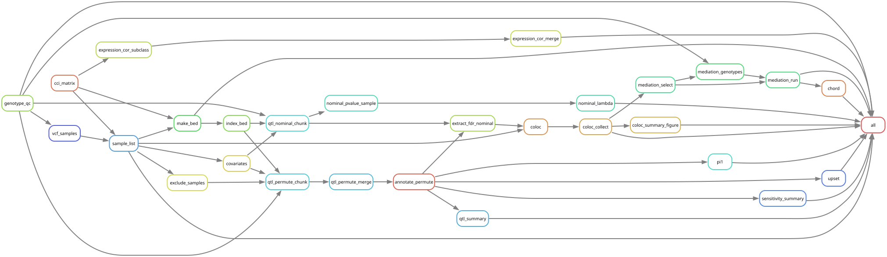
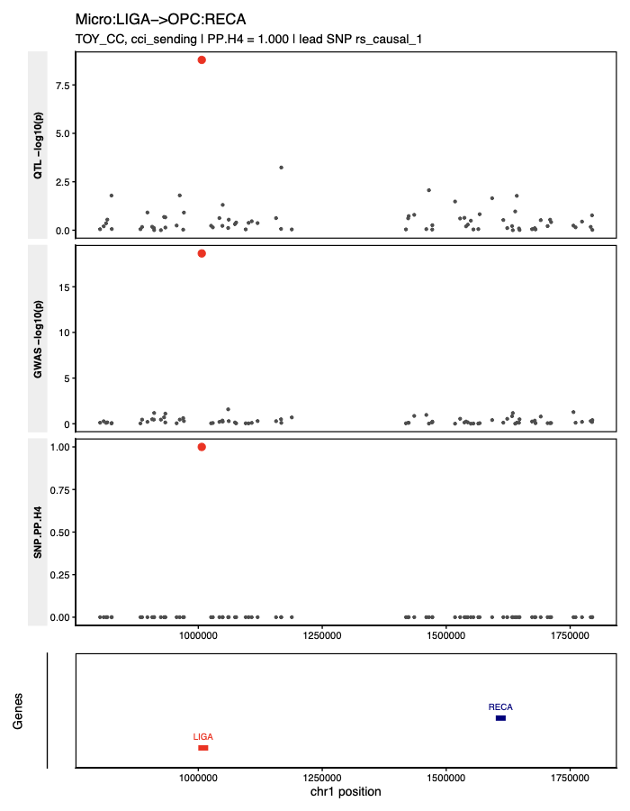

# qtl-pipeline

[](https://github.com/lyrasheu21/qtl-pipeline/actions/workflows/ci.yml)

A config-driven Snakemake pipeline for **cis-QTL mapping with QTLtools**, from raw genotypes and
phenotypes to colocalisation with disease GWAS. It ships with a small R package, **`qtlpost`**,
for the downstream analysis.

The same workflow handles different molecular phenotypes through *adapters*:

| Adapter | Input | Example use |
|---|---|---|
| `bed` | an existing QTLtools phenotype BED | CAGE-seq promoter/enhancer QTLs, anything already in BED form |
| `matrix` | feature × sample table + coordinates | eQTL, caQTL, pQTL |
| `cci` | donor × cell–cell-interaction score matrix | interaction QTLs, mapped at the ligand (*sending*) and at the receptor (*receiving*) |



**Layer 1: pipeline (raw inputs → standard QTL outputs)**
1. **Genotypes:** donor subset and plink QC (missingness, MAF, HWE, haplotype missingness), which can be turned off for pre-cleaned VCFs. Genotype PCs are read from a file or computed with plink2.
2. **Phenotypes:** an adapter builds the QTLtools BED and a phenotype annotation table (`gene`, `group`, optional interaction `partner`). It can map assay sample IDs to donors and average replicates.
3. **Covariates:** metadata covariates with transforms, genotype PCs, and hidden factors (a PEER factor file, or phenotype PCs computed in the pipeline).
4. **cis-QTL mapping:** QTLtools `cis --normal --std-err` permutation and nominal passes, chunked for clusters, with optional `--grp-best` (e.g. several peaks of one gene tested together).
5. **QC and standard outputs:**
   - q-values per group or globally, with π0 diagnostics
   - QQ plots, p-value histograms and genomic λ
   - sensitivity runs, including a **hidden-factor (K) sweep**

   The outputs are documented in [docs/output_contract.md](docs/output_contract.md).

**Layer 2: downstream** (`qtlpost`, also callable as pipeline modules)
- colocalisation with GWAS (coloc), with Gold/Silver/Bronze tiers and locus plots
- MAGMA gene-set enrichment
- π1 replication in an eQTL resource
- mediation through gene expression
- phenotype–expression correlation
- summary figures

## Quickstart (toy data)

The repo includes synthetic datasets (60 donors, 2 chromosomes) with two planted causal variants.
A working run recovers them as FDR-significant QTLs that colocalise with the toy GWAS.

```bash
git clone https://github.com/lyrasheu21/qtl-pipeline.git && cd qtl-pipeline
conda create -n snakemake -c conda-forge -c bioconda "snakemake>=8" "conda>=24.7" && conda activate snakemake

# QTLtools: build it once (Linux), or see "Dependencies" below
bash tools/qtltools/install_qtltools.sh tools

snakemake --profile profiles/local --configfile tests/configs/cage.yaml   tests/configs/real_qtltools.yaml
snakemake --profile profiles/local --configfile tests/configs/cci.yaml    tests/configs/real_qtltools.yaml
snakemake --profile profiles/local --configfile tests/configs/matrix.yaml tests/configs/real_qtltools.yaml
```

Results land in `results_test/<config>/`. On a machine without QTLtools (e.g. macOS), use
`tests/configs/mock.yaml` instead of `real_qtltools.yaml`. It swaps in a small regression-based
stand-in with the same interface, which is only meant for trying the workflow.

<p align="center">
  
</p>

## Running on your own data

1. Copy an example config: [`config/examples/cage.yaml`](config/examples/cage.yaml),
   [`cci.yaml`](config/examples/cci.yaml) or [`eqtl_matrix.yaml`](config/examples/eqtl_matrix.yaml).
   Fill in the paths. Every parameter is documented in [`config/config.yaml`](config/config.yaml).
2. For colocalisation, list GWAS summary statistics in [`config/gwas.tsv`](config/gwas.tsv),
   with a column mapping per study.
3. Run locally or on a cluster:
   ```bash
   snakemake --profile profiles/local --configfile my_config.yaml
   snakemake --profile profiles/lsf   --configfile my_config.yaml   # or profiles/slurm
   ```

Frequently tuned settings:

| Setting | Meaning |
|---|---|
| `genotypes.qc.enabled`, `genotypes.qc.hwe` | Genotype QC on/off, HWE threshold (default 1e-6) |
| `phenotypes.<name>.fdr_group_by` | `group` (e.g. per cell subclass) or `none` (one global q-value) |
| `phenotypes.<name>.fdr_method` | `storey` (q-values, default) or `bh` (Benjamini–Hochberg, more conservative) |
| `phenotypes.<name>.min_nonzero_fraction` | Drop phenotypes that are zero or missing in too many donors |
| `phenotypes.<name>.grouped_permutation` | QTLtools `--grp-best`, grouping phenotypes by the BED `gid` column |
| `covariates.hidden_factors` | `file` (e.g. PEER factors, `.RData` or TSV, optional sample map) or `phenotype_pca`, with `k` factors |
| `sensitivity.sweep_k` | Extra permutation runs per number of hidden factors, summarised as hits vs K |

## Dependencies

- **Snakemake ≥ 8** and conda. All other tools (plink 1.9/2, bcftools, R packages) come from the
  conda environments in [`envs/`](envs/).
- **QTLtools v1.3.1** ([qtltools.github.io](https://qtltools.github.io/qtltools/); Delaneau et al.
  2017, *Nat Commun*) is not on conda. Pick one of:
  1. an existing installation (e.g. an HPC module): `qtl.qtltools_binary: QTLtools`
  2. build from source on Linux: `bash tools/qtltools/install_qtltools.sh tools`, then
     `qtl.qtltools_binary: tools/bin/QTLtools`
  3. the container in [`tools/qtltools/Dockerfile`](tools/qtltools/Dockerfile): set `qtl.container`
     and run with `--sdm conda apptainer`
- **MAGMA** (only for the MAGMA module): set `magma.binary`.

## `qtlpost` R package

```r
# needs Bioconductor qvalue + limma; then:
# remotes::install_github("lyrasheu21/qtl-pipeline", subdir = "qtlpost")
library(qtlpost)
res <- read_qtl_results("results/cage")
fdr_summary(res$permute, by = c("set", "group"))
```

See the vignette ([`qtlpost/vignettes/qtlpost.Rmd`](qtlpost/vignettes/qtlpost.Rmd)) for
colocalisation, locus plots and the hidden-factor sweep on the bundled toy results.

## Repository structure

```
config/            config.yaml (documented template), examples/, gwas.tsv, cell_types.tsv, schema/
workflow/          Snakefile, rules/ (01 genotypes ... 06 downstream), scripts/ (thin wrappers)
qtlpost/           R package: R/, tests/testthat/, vignettes/, inst/extdata/ (toy results)
envs/              conda environments
profiles/          local, LSF and SLURM execution profiles
tools/qtltools/    QTLtools build script and Dockerfile
tests/             toy data + generator, test configs, mock QTLtools
docs/              output contract, rule graph, example figures
.github/           CI: package tests, QTLtools build, toy pipelines with real QTLtools
```

## Notes

- **Methodological choices:**
  - q-values fall back to a base-R Storey implementation when `qvalue` cannot estimate π0, and
    to Benjamini–Hochberg for groups with fewer than 20 phenotypes.
  - Donors missing any covariate are dropped and reported. QTLtools itself only uses samples
    present in all of the VCF, BED and covariate file.
  - Case-control GWAS are run in coloc as `type = "cc"` with their case fraction (`config/gwas.tsv`).
- **Matching inputs:** SNP IDs must match across genotypes, GWAS and eQTL files, and all inputs
  must use one genome build.
- **Origin:** built from exploratory analysis notebooks for interaction QTLs and CAGE-seq QTLs.
  Along the way the rewrite fixed a q-value grouping bug and a covariate-file bug, and replaced
  hand-typed summary figures with ones generated from results.

## License

[MIT](LICENSE) © 2026 Lyra Sheu
